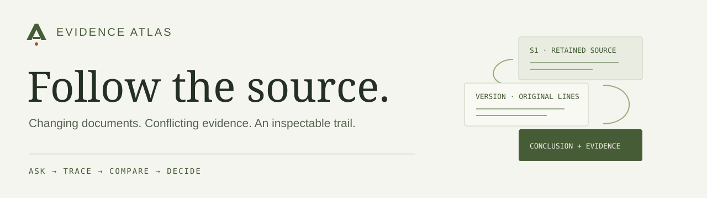
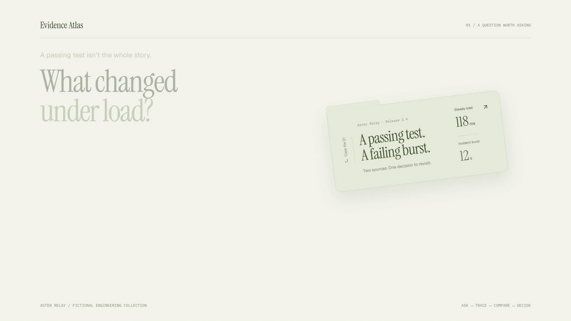
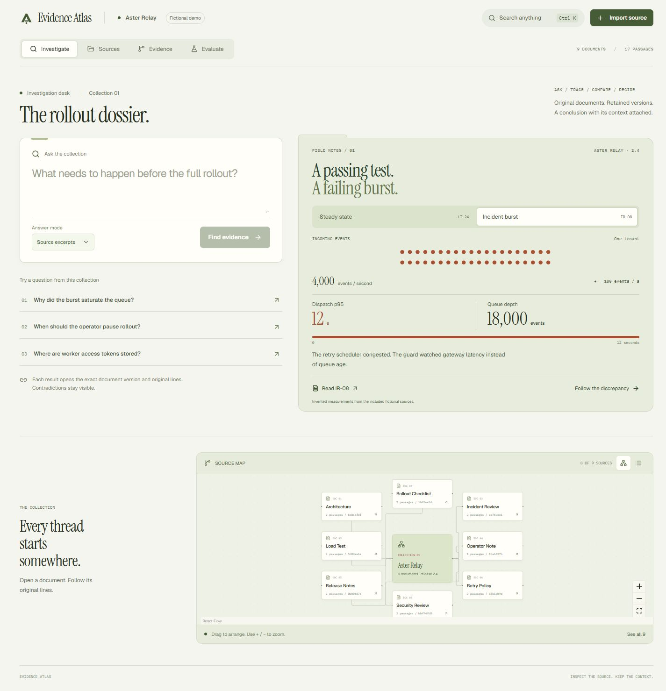
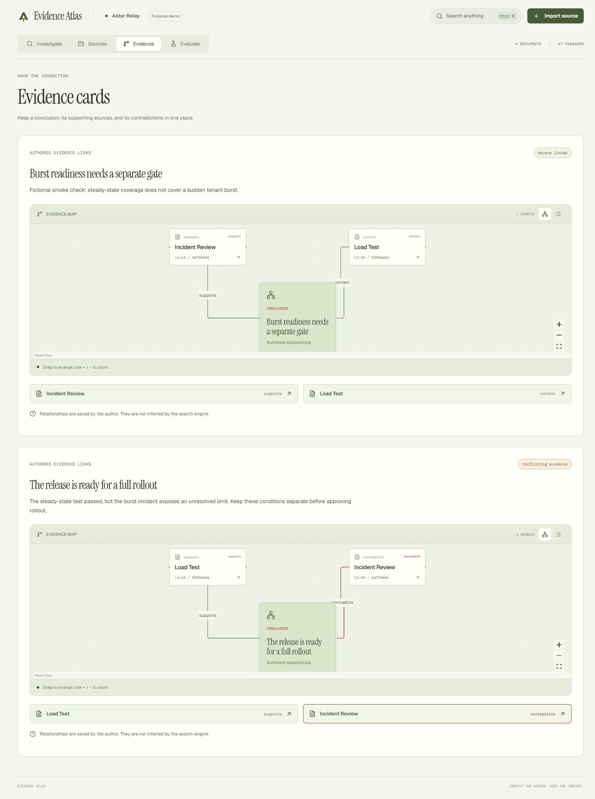
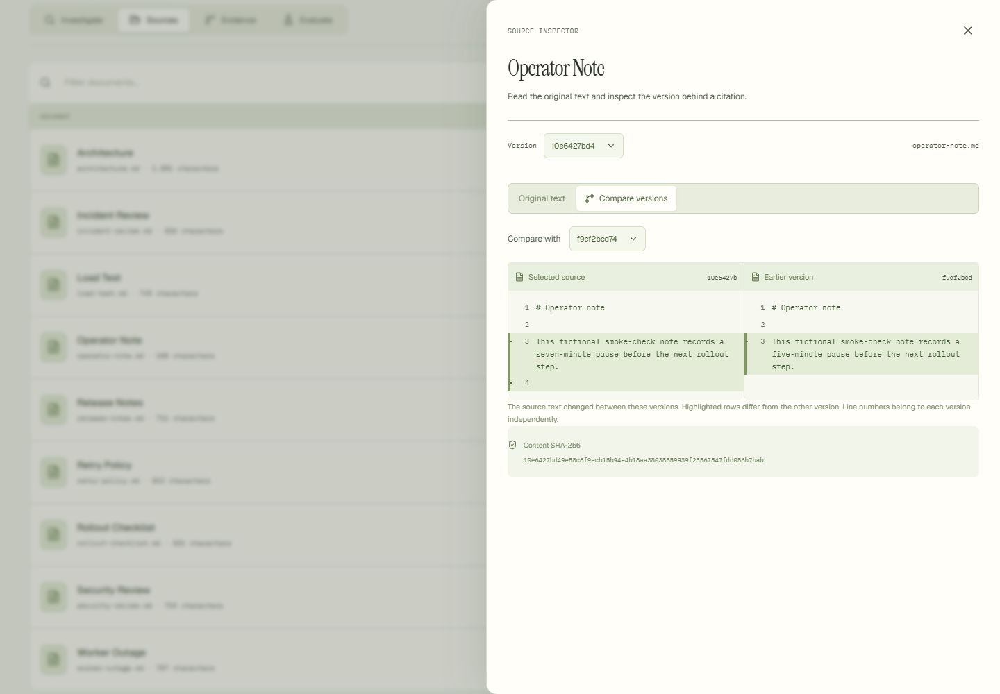
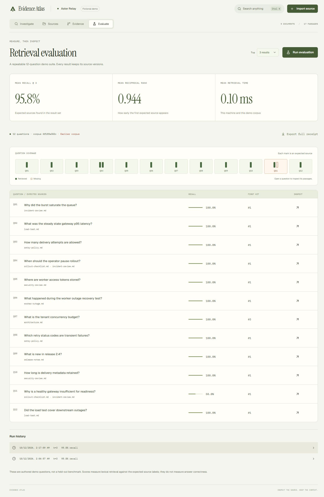

# Evidence Atlas

**An investigation workspace for engineering evidence that changes, conflicts, and needs checking.**

A passing test and a failed rollout can both be real. Atlas keeps their conditions, source versions and line references in view, so a conclusion has an inspectable trail behind it.

[Watch the film](docs/media/evidence-atlas.mp4) · [Run the app](#run-locally) · [Engineering case study](docs/CASE-STUDY.md) · [Architecture](docs/ARCHITECTURE.md)

[](docs/media/evidence-atlas.mp4)

*32-second component film · 1080p / 60 fps · original score. The film renders the app’s React components with fictional demonstration props. [Editable motion project →](videos/evidence-atlas-film/README.md)*

## One investigation, end to end

The included case follows **Aster Relay**, a fictional service preparing release 2.4. A steady load test passes at 600 events per second. A burst at 4,000 events per second exposes a tenant dispatch backlog: the overload guard watches gateway latency while the queue grows elsewhere.

The interesting question is what the passing test actually supports. The opening dossier makes the two operating conditions comparable, then leads directly into their source documents.

1. **Ask.** Retrieve relevant passages and open each answer’s numbered citations.
2. **Trace.** Inspect the cited text, original line numbers, version and content hash.
3. **Compare.** Import a revised source. Inspect changed rows while keeping earlier citations intact.
4. **Decide.** Save a conclusion with explicit supporting, contradictory and contextual source links.
5. **Check.** Run the twelve-question retrieval suite. Open the misses and compare saved runs against their corpus fingerprints.

Everything needed for that journey is included. The default mode selects verbatim source excerpts and runs locally without an account or provider connection.

<table>
<tr>
<td width="50%"><a href="docs/images/workbench.png"></a><br /><b>Start with the conditions.</b><br />Traffic, latency and queue depth lead into the actual sources.</td>
<td width="50%"><a href="docs/images/evidence-card.png"></a><br /><b>Keep disagreement visible.</b><br />A conclusion can retain evidence on both sides.</td>
</tr>
<tr>
<td><a href="docs/images/source-inspector.png"></a><br /><b>Inspect the change.</b><br />Separate hashes, line numbers and changed rows preserve the earlier record.</td>
<td><a href="docs/images/evaluation.png"></a><br /><b>Inspect the miss.</b><br />Per-question results explain what an aggregate score hides.</td>
</tr>
</table>

*Screens show the fictional demo plus an operator note imported in two versions and an additional saved card. The original eight-source evaluation is labelled as an earlier corpus after those imports.*

## Decisions that shape the system

| Decision | What it makes possible |
| --- | --- |
| Separate the active search index from retained versions | New searches see revised sources; existing citations still open the exact earlier text. |
| Capture passages and corpus identity in one read snapshot | A concurrent import cannot pair old retrieval results with a new corpus fingerprint. |
| Store evidence relationships explicitly | “Supports” and “contradicts” remain authored judgments linked to inspectable chunks. |
| Use a transparent lexical baseline | FTS5/BM25 retrieval is local, inexpensive and reproducible; its vocabulary gaps are measurable. |
| Preserve per-case evaluation results | Recall and reciprocal rank can be checked against returned document names, ranks and source passages. |
| Share presentation components with the film | Citation, document, comparison and assay views are rendered from component source rather than browser screenshots. |

The [case study](docs/CASE-STUDY.md) explains the problem, invariants, interaction design and tradeoffs. The [architecture](docs/ARCHITECTURE.md) covers identity, import transactions, retrieval snapshots, cancellation and storage boundaries.

## Run locally

Requires **Python 3.11+** with SQLite FTS5, **Node 22.12+**, and [uv](https://docs.astral.sh/uv/).

```sh
uv sync --extra dev --frozen
cd web
npm ci
npm run build
cd ..
uv run atlas serve
```

Open **http://127.0.0.1:8765**. First start seeds eight fictional Markdown documents and one evidence card into `.atlas/workspace.sqlite`. Dependencies must be installed before offline use.

Try **“Why did the burst saturate the queue?”**, then open a citation. To inspect version retention, import a `.md` or `.txt` file, edit it and import it again under the same name.

**Ctrl K / ⌘ K** opens document, answer and action search. Tabs support arrow keys, Home and End. Source maps have a complete list alternative; small screens start with it. The source inspector restores focus when closed.

For frontend development, keep `uv run atlas serve` running and use `npm run dev` inside `web`. Vite serves port 5173 and proxies `/api` to port 8765.

## A result you can inspect

The checked-in [evaluation receipt](docs/demo-evaluation.json) records the eight-source, twelve-question authored fixture:

| Mean Recall@3 | Mean reciprocal rank | Visible gaps |
| --- | --- | --- |
| **95.8%** | **0.944** | Q07’s expected source ranks third; Q11 misses one of two expected sources. |

This is a small retrieval fixture, not a held-out benchmark or a measure of general answer correctness. The receipt includes returned passages, corpus fingerprint and suite hash. Timing depends on the machine and this tiny corpus.

Save a fresh receipt directly to disk:

```sh
uv run atlas evaluate --database .atlas/evaluation.sqlite --k 3 --output .atlas/evaluation.json
```

The CLI seeds an empty database; an existing database is evaluated against its active documents. The built-in suite expects the included fictional document names.

## Built across the stack

**Python / FastAPI / SQLite FTS5** handle import, version retention, retrieval, evidence cards and evaluation receipts. **React / TypeScript / Vite** provide the investigation workspace. **Radix, cmdk, Motion and React Flow** support keyboard controls, source navigation and interaction; adapted component sources and fonts are credited in [THIRD-PARTY.md](THIRD-PARTY.md). **Remotion** renders the editable component film.

Twenty-one backend tests cover storage invariants, source retention, query handling, evaluation snapshots and API behavior. Twelve interface tests cover cited-version requests, cancellation, recovery, keyboard interaction, custom selection and safe version comparison. [Verification details →](docs/VERIFICATION.md)

```sh
uv run pytest
uv run ruff check atlas tests
uv run ruff format --check atlas tests
cd web
npm test
npm run format:check
npm run build
```

<details>
<summary><b>Optional connected answers</b></summary>

Set these variables on the server before starting it:

```sh
export ATLAS_PROVIDER_URL=http://127.0.0.1:8000/v1
export ATLAS_MODEL=your-served-model
# ATLAS_PROVIDER_KEY is optional for endpoints that require authentication.
```

The server appends `/chat/completions` to the base URL and sends the question and retrieved passages to that endpoint. Credentials stay on the server. Do not put them in frontend variables or commit an `.env` file.

Answers must include at least one supplied `[S1]`-style label and no unknown labels. Label validity does not establish that a claim is supported. Provider behavior is covered by mocked responses; a live provider run is not claimed.

</details>

<details>
<summary><b>Container</b></summary>

```sh
docker build -t evidence-atlas .
docker run --rm -p 127.0.0.1:8765:8765 -v atlas-data:/app/.atlas evidence-atlas
```

The container runs as a non-root user. The source quickstart uses frozen lockfiles; the container installs the Python package’s declared dependency ranges. It is not advertised as a bit-for-bit reproducible image.

</details>

## Scope and next steps

Atlas is a local, single-workspace prototype. Imports are UTF-8 Markdown/text, limited to 2 MB. Search uses sixteen-line chunks with a twelve-line stride, lexical ranking and one passage per document. Comparison previews are bounded to 240 lines. Evidence relationships are authored; there is no automatic contradiction detection.

There is no authentication, workspace isolation, deletion workflow, semantic reranker or PDF extraction. A larger deployment would need bounded candidate retrieval, pagination, storage management and access controls. Runtime databases and exports can contain whatever text you import and belong outside source control.

The next useful experiment is retrieval beyond the authored fixture: expand questions and source vocabulary, then compare the current lexical baseline with reranking while preserving the same inspectable receipts.

## Explore the implementation

| Read | Purpose |
| --- | --- |
| [Engineering case study](docs/CASE-STUDY.md) | Problem, design decisions, failure modes and the complete investigation |
| [Architecture](docs/ARCHITECTURE.md) | Storage, identity, transactions, retrieval and request lifetime |
| [Design](docs/DESIGN.md) | Case-file direction, interaction patterns and applied resources |
| [API](docs/API.md) | Routes, payloads and local provider configuration |
| [Verification](docs/VERIFICATION.md) | Performed checks, fixture results and their scope |
| [Motion project](videos/evidence-atlas-film/README.md) | Editable scenes, shared components, score generator and export commands |

All included engineering documents, evaluation cases and film demonstration props are fictional.
