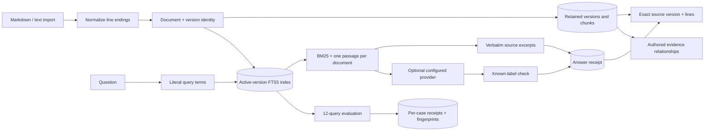

# Architecture

Atlas separates active search state from retained evidence. Replacing a source changes future retrieval without rewriting the version referenced by an existing citation.

## Identity and import transactions

`documents.id` is a prefix plus a truncated SHA-256 of the case-folded document name. Re-importing the same name therefore targets one document. The display title comes from its first import. This is a logical name, not a filesystem path: separators are rejected, and titles are never used to write uploaded files.

Line endings are normalized before the complete source text is hashed. A version ID combines document identity and the full content hash. Re-importing identical normalized text does not create another version; it reactivates the existing version. SHA-256 is a reproducibility mechanism, not proof that a source is true or trusted.

Each new version is split into sixteen-line windows at a twelve-line stride. Empty windows are skipped. A chunk ID combines the version ID and zero-based window start. Line locators are one-based and inclusive. A single transaction inserts versions/chunks, replaces that document's FTS rows, and updates its active-version pointer.

Earlier chunks remain in ordinary SQLite tables. Only the active version is searchable. SQLite connections enable foreign keys, close explicitly, use a ten-second busy timeout, and commit or roll back through the connection context. WAL is enabled when the store is created.

## Retrieval

Queries are lowercased into Unicode word terms, deduplicated, stripped of a small explicit stop-word set, and capped at 32 terms. Terms are quoted and joined with `OR`, so user punctuation does not become FTS query syntax.

The FTS tokenizer uses Porter stemming with `unicode61`. BM25 weights title twice as strongly as body. Smaller scores rank first; chunk ID breaks ties. Results keep the best passage per document and receive per-response labels `S1`, `S2`, and so on. A passage's complete body, version ID, document ID, hash and line range are returned.

Retrieval and fingerprint generation share a read transaction. An import during retrieval cannot produce passages from one corpus and a fingerprint from another snapshot. The fingerprint hashes the sorted active-version IDs. It changes when an active source changes, including reactivation of an old version.

## Answer and request lifetime

Offline answers choose two non-heading, nonempty lines from each retrieved passage, favouring lines that contain question terms. Their original order is preserved. This is selection, not synthesis.

The optional provider path posts the question and retrieved passages to a configured Chat Completions endpoint. It uses a 45-second timeout, does not follow redirects, and returns generic errors rather than leaking transport details or credentials. Missing configuration, unusable output, missing labels and unknown labels are separate failures. Label validity does not measure entailment, completeness or prompt-injection resistance.

The browser uses an AbortController and request identity. Cancelling clears the current request; a late completion is ignored even if its transport fails to honour abort. The server checks disconnection before persisting an answer. Provider work already in flight is not guaranteed to stop immediately on disconnect.

## Cards and history

Evidence cards store user-authored titles, notes and typed chunk links. Chunk existence is validated before saving. The browser reports when a linked version is no longer active. Supporting or contradictory relationships are editorial records; they are not inferred from source text.

Answers and evaluations retain a JSON payload and timestamp. Lists return the twenty newest receipts of each kind; older receipts can still be fetched by ID. They are not automatically pruned. A source inspector always requests the referenced version rather than substituting the latest text.

## Evaluation contract

The authored suite defines twelve questions and one or more expected document names per question. Each case records the expected names, returned names, Recall@k, reciprocal rank, measured retrieval time and complete passages. All queries and the corpus fingerprint share a read snapshot. The suite hash identifies the canonicalized case definitions; the completed receipt is then persisted separately.

Recall is the fraction of expected documents in the result set. Reciprocal rank is the inverse rank of the first expected document, or zero when none appears. The displayed metrics are means over the twelve cases. They assess retrieval against these labels, not answer correctness or a general domain benchmark.

## Interface boundaries

The source map connects collection membership, retrieval results or authored card links. It makes no semantic similarity claim. Nodes can be arranged for inspection; positions are view state and are not persisted. The map displays up to eight sources, labels that limit, and provides a list of every source. Small screens start with the list.

The browser never receives provider credentials. Imported text is rendered in React text nodes, including version comparison; source text is not executed as Markdown HTML or inserted as syntax-highlighted HTML. Comparison previews show the first 240 lines of each version and identify that limit. Original text remains available in the inspector.

## Deliberate limits

Atlas has one local workspace, no authentication or production exposure protections, no deletion workflow, no semantic index, and no automatic evidence quality scoring. Large corpora would need bounded candidate retrieval, pagination and storage management. The current search fetches matching rows before document deduplication; the fictional corpus does not establish scalability. A distributed deployment would also need workspace isolation, authentication, request limits, operational monitoring and a storage migration strategy.
